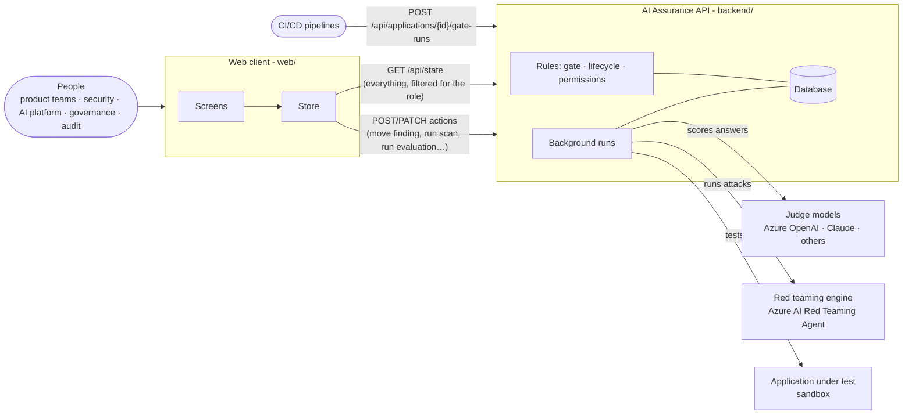

# AI Assurance

One application that answers one question for every AI application in the organization: **is it ready and safe to release?**

It implements the *AI Evaluation and Red Teaming Framework v1.0* ([`AI_Evaluation_and_Red_Teaming_Framework.pdf`](AI_Evaluation_and_Red_Teaming_Framework.pdf)). It brings two kinds of assurance together:

- **Evaluation**: does the application do its job well for normal users? (Is it accurate, grounded in its sources, complete?)
- **Red teaming**: can someone make it fail on purpose? (Leak data, follow hidden instructions, produce harmful content, take actions it should not?)

Both feed **one release gate**, one findings process and one evidence pack, across RAG assistants, agents, multi-agent systems and MCP tool servers.

> New to the project, or not technical? Start with the **[plain-language guide](PLAIN-LANGUAGE-GUIDE.md)**.

## The two parts

| Part | Folder | Technology | Responsibility |
|---|---|---|---|
| **AI Assurance API** | [`backend/`](backend/) | Python, FastAPI, SQLAlchemy | Holds every record and enforces every rule: registry, gate engine, findings lifecycle, permissions, evaluation runs with judge models, red team scans, manual testing, evidence. |
| **Web client** | [`web/`](web/) | React, TypeScript, Vite | The user interface: dashboards, gate decisions, scan heat maps, the findings board, evaluation results, model management. It holds no rules of its own. |

## How they connect



1. **One snapshot in, actions out.** On load, the web client fetches `GET /api/state`: the whole portfolio, with each application's gate decision already computed and anything the user's role may not see removed. Every action (closing a finding, starting a scan) is a request to the API, followed by a fresh snapshot, so every screen stays consistent.
2. **The API decides; the client shows.** If an action breaks a rule, the API refuses it with a plain-language reason ("A regression test is required to close a finding") and the client shows that message. Pipelines call the same API, so they get the same decisions people see.
3. **Long work runs in the background.** Scans and evaluations return immediately with a *Running* record. The API works in the background, and the client polls once a second to show progress until the run completes.
4. **Roles travel with each request.** During development the client sends the role being previewed in an `X-Role` header. In production this is replaced by Entra ID sign-in.
5. **In development, one origin.** The client's dev server forwards `/api` to the API on port 8000, so the browser sees a single site.

## Quick start

You need Python 3.11+ and Node.js 20+.

```bash
# Terminal 1: the API on http://localhost:8000 (API docs at /docs)
cd backend
python3 -m venv .venv
.venv/bin/pip install -r requirements-dev.txt
.venv/bin/uvicorn app.main:app --reload

# Terminal 2: the web client on http://localhost:5173
cd web
npm install
npm run dev
```

Open **http://localhost:5173**. The database starts with a sample portfolio of six fictional applications (PeopleDesk Assistant, LedgerLens Agent, Insight Copilot, Onboard Guide, VendorHub MCP Server, Comms Composer). Use the role switcher at the top right to see the app as a product team member, product owner, security analyst, AI platform engineer, governance board member or auditor.

No keys are needed: the default judge and red teaming engine are simulations that make no network calls. To score with real models, see [Configure a real judge model](backend/docs/setup.md#4-configure-a-real-judge-model).

Run the tests:

```bash
cd backend && .venv/bin/python -m pytest      # API: 23 tests
cd web && npm run build                       # client: type-check and build
```

## Repository layout

```
.
├── README.md                     You are here
├── PLAIN-LANGUAGE-GUIDE.md       What this is and why it matters, without jargon
├── AI_Evaluation_and_Red_Teaming_Framework.pdf    The framework this implements
├── AI Assurance Application - Sample Screens.html  The original screen mock-ups
├── backend/                      AI Assurance API (Python)
│   ├── app/                      Code
│   ├── library/                  Test library files (sample golden datasets)
│   ├── tests/                    pytest suite
│   └── docs/                     Backend documentation
└── web/                          Web client (React)
    ├── src/                      Code
    └── docs/                     Frontend documentation
```

## Documentation

| | Backend | Web client |
|---|---|---|
| Start here | [backend/docs](backend/docs/README.md) | [web/docs](web/docs/README.md) |
| Setup | [Setup guide](backend/docs/setup.md) | [Setup guide](web/docs/setup.md) |
| Architecture | [Architecture](backend/docs/architecture.md) | [Architecture](web/docs/architecture.md) |
| Rules and screens | [Domain rules](backend/docs/domain-rules.md) | [Screens](web/docs/screens.md) |
| Reference | [API](backend/docs/api.md) · [Data model](backend/docs/data-model.md) | [Design system](web/docs/design-system.md) · [Contributing](web/docs/contributing.md) |
| Quality | [Testing](backend/docs/testing.md) · [Operations](backend/docs/operations.md) | [Testing](web/docs/testing.md) |
| Decisions | [ADRs](backend/docs/adr/README.md) | [ADRs](web/docs/adr/README.md) |

## Status

Working end to end with simulated engines and sample data, with real judge model support for Azure OpenAI, Anthropic and OpenAI-compatible endpoints.

Not production-ready yet. The main gaps:

- **Sign-in:** the development role header must be replaced with Entra ID.
- **Durability:** background runs need a durable queue to survive restarts.
- **Untested Azure adapter:** the Azure AI Red Teaming Agent adapter has not been run against a live project.
- **Placeholder integrations:** work item creation, transcript storage and gate exceptions are not connected to real systems yet.

The full list is in [backend/docs/operations.md](backend/docs/operations.md).
