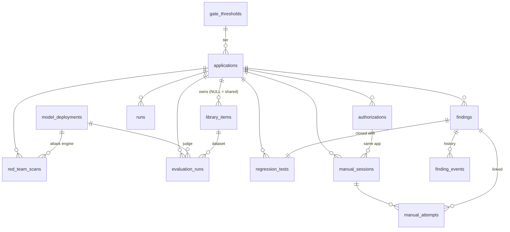

# PostgreSQL schema scripts

SQL scripts that create the AI Assurance database on **PostgreSQL 14 or later**, including Azure Database for PostgreSQL Flexible Server. They define the target production schema, with integrity enforced by the database itself, not just by the API.

> **Status: target schema, not yet used by the API.** The API currently creates its own tables through SQLAlchemy (`app/models.py`) and runs on SQLite by default. Aligning the API with these scripts is the next step; see [How this differs from the current API tables](#how-this-differs-from-the-current-api-tables). Until then, do not point the API at a database created from these scripts.

## Contents

```
database/
├── README.md                       This file
├── install.sql                     Runs 01–12 in one transaction
├── uninstall.sql                   Drops the schema (destructive, asks for confirmation)
└── sql/
    ├── 00_create_database.sql      Database and login roles (superuser, run once)
    ├── 01_schema_and_functions.sql Schema "assurance", shared ID sequence, trigger functions
    ├── 02_gate_thresholds.sql      Release gate thresholds per tier, with the framework defaults
    ├── 03_applications.sql         Application registry
    ├── 04_model_deployments.sql    Judge models and attack engines
    ├── 05_library_items.sql        Test library catalog
    ├── 06_red_team_scans.sql       Automated red team scans
    ├── 07_evaluation_runs.sql      Evaluation runs scored by judge models
    ├── 08_findings.sql             Findings, append-only finding history, regression tests
    ├── 09_run_history.sql          Run history (append-only)
    ├── 10_manual_testing.sql       Authorizations, manual sessions, attempts
    ├── 11_reporting_views.sql      Read-only views for the AI Metrics Dashboard and auditors
    └── 12_roles_and_grants.sql     Privileges for the app and reporting roles
```

## Install

**1. Create the database and roles** (once, as a superuser):

```bash
psql -h <host> -U postgres -d postgres \
     -v app_password='<strong password>' \
     -v reporting_password='<strong password>' \
     -f backend/database/sql/00_create_database.sql
```

This creates two login roles and the `assurance` database owned by `assurance_app`:

| Role | Purpose | Access |
|---|---|---|
| `assurance_app` | The API's connection | Owns the schema; reads and writes every table |
| `assurance_reporting` | AI Metrics Dashboard, auditors' queries | `SELECT` on the reporting views only; no direct table access |

On Azure Database for PostgreSQL, create the `assurance` database in the portal or with `az postgres flexible-server db create`, then run only the role statements as the server admin.

**2. Create the schema** (as `assurance_app`):

```bash
psql -h <host> -U assurance_app -d assurance -f backend/database/install.sql
```

Everything runs in one transaction: if any statement fails, nothing is created. It ends by listing the tables and recording version `1.0.0` in `assurance.schema_version`.

**3. Remove it** (development and test only):

```bash
psql -h <host> -U assurance_app -d assurance -v confirm=yes -f backend/database/uninstall.sql
```

## Tables

| Table | Rows | Framework |
|---|---|---|
| `gate_thresholds` | One per risk tier (Low, Medium, High), seeded with the framework's starting criteria | §9 |
| `applications` | One per registered AI application, with threat model and current release candidate | §10.1, §5 |
| `model_deployments` | Judge models and attack engines; never secrets | §10.2, §12.2 |
| `library_items` | Test library catalog: golden datasets, scenarios, seeds, canary sets, regression sets | §10.1 |
| `red_team_scans` | One per automated scan, with the heat map; no attack content | §7.2, §10.3 |
| `evaluation_runs` | One per evaluation, with the judge used and per-case verdicts | §6 |
| `findings` | One per weakness | §8, §10.3 |
| `finding_events` | Every change to a finding, **append-only** | §8.2 |
| `regression_tests` | One per closed finding | §8.2 |
| `runs` | Run history: gate decisions, evaluations, scans, exercises, **append-only** | §10.4 |
| `authorizations` | Written authorizations for red teaming | §7.6 |
| `manual_sessions` | Manual expert exercises | §7.5 |
| `manual_attempts` | Every attempt logged in a session, **append-only** except linking a finding | §7.5 |
| `schema_version` | Installed schema versions | |



## What the database enforces

These rules hold even if a bug in the API, a script or a manual query tries to break them.

**Framework rules**

| Rule | How |
|---|---|
| A finding cannot be **Closed** without a regression test (§8.2) | `findings.closed_requires_regression_test`, plus a deferred trigger checking the test belongs to that finding |
| **Accepted risk** needs approval, an expiry date and compensating controls (§8.2) | `findings.accepted_risk_is_complete` |
| Every non-Low open finding has a deadline (§8.1) | `findings.deadline_unless_low` |
| Finding history, run history and manual attempts cannot be edited or deleted | `forbid_change()` triggers; attempts may only be linked to a finding once |
| Red teaming only in sandbox or staging, with an authorization for the same application (§7.6) | `authorizations.environment` check; composite foreign key `manual_sessions (authorization_id, app_id)` |
| Attack material is restricted and stored in restricted storage (§7.6) | `library_items.attack_material_restricted` |
| Judges and attack engines use allowed providers; attack engines are only the simulation or the Azure AI Red Teaming Agent | `model_deployments.provider_allowed_for_purpose` |
| No secrets: only the name of the key's environment variable | `model_deployments.api_key_env` format check; there is no key column |
| One default model per purpose, and the default is enabled | partial unique index `model_deployments_one_default`; `default_is_enabled` |
| Claude models carry no temperature | `model_deployments.no_temperature_for_claude` |
| Canary leaks and open critical findings always block (§9) | `gate_thresholds.canary_leaks = 0`, `open_critical = 0` |
| The per-category ASR limit is never stricter than the overall one | `gate_thresholds.category_limit_not_below_overall` |
| An application's evaluation profile matches its type | `applications.profile_matches_type` |

**Data quality**

- **Foreign keys** on every reference to an application, model, dataset, finding, authorization or session, all `ON DELETE RESTRICT`: evidence cannot be orphaned.
- **CHECK constraints** on every fixed value list (tiers, stages, severities, statuses, sources, providers, complexities, strategies, risk categories, OWASP IDs, entry points, outcomes).
- **ID formats** checked (`FND-0231`, `RT-1001`, `EV-0205`, `uc-peopledesk-assistant`, `judge-gpt-41`).
- **Ranges**: percentages 0–100, progress 0–100, agreement 0–1, successes ≤ attempts, deadlines after opening.
- **Consistency**: completed runs are at 100% and have a finish time; failed runs have an error.

## Design choices

| Choice | Why |
|---|---|
| Dedicated `assurance` schema | Keeps the app's objects together and lets grants be schema-wide |
| `text` with `CHECK` instead of `ENUM` types | Adding a value is a one-line constraint change; ENUM values cannot be removed or reordered |
| `text[]` arrays for value lists (complexities, strategies, OWASP IDs, testers) | Queryable (`'LLM01' = ANY(owasp)`) and checked against allowed values with `<@` |
| `jsonb` for structures always read and written whole (threat model, release, heat map, scenarios, metrics, case results) | Matches how the API uses them; `jsonb_typeof` checks guarantee the shape at the top level |
| Separate tables for audit trails (`finding_events`, `manual_attempts`, `runs`) | Append-only enforcement and queries need rows, not JSON arrays |
| `timestamptz` everywhere | Correct time zone handling and date arithmetic (overdue, mean time to fix) |
| One shared ID sequence (`record_id_seq`, `next_record_id('FND')`) | IDs unique and ordered across findings, scans, regression tests, runs and evaluations |
| Reporting through views only | §11: the dashboard sees categories, rates and summaries, never raw attack content or evidence detail |

## Reporting views

| View | Shows |
|---|---|
| `v_application_assurance` | Per application: quality index, release attack success rate, open critical/high/total and overdue findings, last gate decision |
| `v_open_findings` | Open findings with overdue flag and days overdue |
| `v_release_scan_asr` | Attack success rate of every completed release scan (trend by release) |
| `v_ec_member_summary` | Applications, open findings, overdue fixes and blocked releases per EC member |
| `v_program_measures` | §12.3 program measures for the whole portfolio |
| `v_mean_time_to_fix` | Mean days to fix by severity |
| `v_judge_usage` | Each judge, how many runs it scored, and whether calibration is due |

Example:

```sql
SELECT name, tier, release_asr_pct, open_critical, overdue, last_gate_result
FROM assurance.v_application_assurance
ORDER BY open_critical DESC, overdue DESC;
```

## How this differs from the current API tables

The API's SQLAlchemy models (`app/models.py`) were written for SQLite and differ in these ways. Aligning them is the next step.

| Area | Current API tables | These scripts |
|---|---|---|
| Location | Default schema | `assurance` schema |
| Timestamps | ISO-8601 text | `timestamptz` |
| Relationships | No foreign keys | Foreign keys everywhere, `ON DELETE RESTRICT` |
| Value lists | Free text | `CHECK` constraints; arrays checked against allowed values |
| Finding history | JSON array in `findings.history` | `finding_events` table, append-only |
| Manual attempts | JSON array in `manual_sessions.attempts` | `manual_attempts` table |
| Risk acceptance | JSON in `findings.acceptance` | Columns `acceptance_approved_by`, `acceptance_expires`, `acceptance_controls` |
| Judge calibration | JSON in `model_deployments.calibration` | Columns `calibration_agreement`, `calibration_sample_size`, `calibrated_at` |
| Authorization dates | `from`, `to` | `valid_from`, `valid_to` |
| Session dates | `start`, `end` | `starts_at`, `ends_at` |
| Shared library items | `app_id = 'shared'` | `app_id IS NULL` |
| ID counter | `counters` table | `record_id_seq` sequence |
| Append-only history | Not enforced | Enforced by triggers |
| Reporting | None | Views and a read-only role |

The API's JSON field names (`appId`, `dueAt`, …) do not change. The alignment happens in `models.py` and `serialize.py`, plus Alembic migrations generated to match these scripts.
