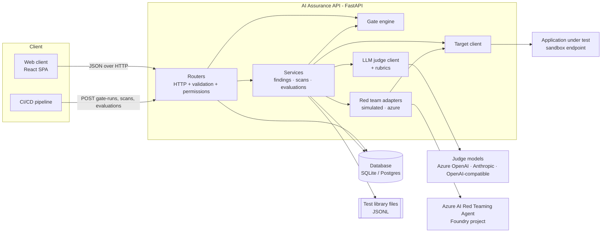
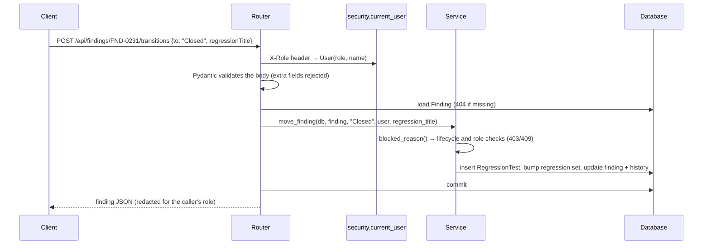
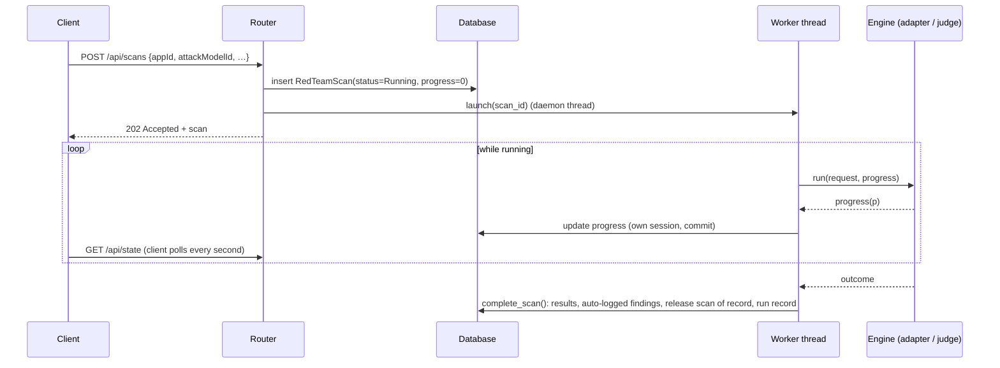
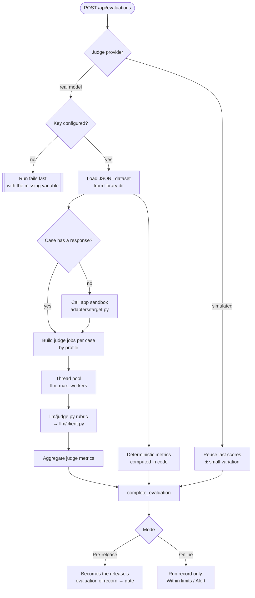

# Architecture

## 1. What the service is responsible for

The framework (§10.1) defines eight modules. All of them live in this one service:

| Framework module | Where it lives |
|---|---|
| Application registry | `routers/applications.py`, `models.Application` |
| Test library | `models.LibraryItem`, files under `library/`, `routers/admin.py` (`/api/library`) |
| Run orchestrator | `services/scans.py`, `services/evaluations.py` |
| Gate engine | `gate.py` |
| Findings tracker | `services/findings.py`, `routers/findings.py` |
| Manual testing workspace | `routers/manual.py` |
| Evidence and reporting | `routers/applications.py` (`/evidence-pack`), run history |
| Administration | `routers/admin.py`, `routers/models.py` (model registry) |

The service is the **single source of truth**. The web client only displays data and sends requests; every rule is enforced here (see [ADR 0003](adr/0003-server-authoritative-rules.md)).

## 2. Component view



### Layers

| Layer | Modules | Rule |
|---|---|---|
| HTTP | `routers/*` | Parse and validate input (`schemas.py`), check permissions (`security.require`), call services, return JSON. No business rules beyond "does this exist" and "may this caller do this". |
| Workflow | `services/*` | The lifecycle rules: what a transition does, what a completed scan writes, how an evaluation becomes the release's evaluation of record. |
| Domain | `gate.py`, `framework.py` | Pure functions and reference data. `evaluate_gate` takes rows and thresholds and returns a decision; it never touches the database. |
| Integration | `adapters/*`, `llm/*` | Everything that leaves the process: red team engines, judge models, the application under test. Swappable behind small interfaces. |
| Persistence | `models.py`, `db.py`, `seed.py` | SQLAlchemy tables. Nested structures that are always read and written whole are JSON columns ([ADR 0002](adr/0002-sqlalchemy-sqlite-json-columns.md)). |

## 3. Request lifecycle

Every request follows the same path:



Errors are plain FastAPI `HTTPException`s with a human-readable `detail`. The web client shows that text to the user as-is, so messages are written for people ("Triage is led by Security"), not for machines.

| Status | Meaning in this API |
|---|---|
| 400 | Unknown role header |
| 403 | The caller's role may not do this |
| 404 | The record does not exist |
| 409 | The action conflicts with the record's state (wrong lifecycle step, gate not passed, already signed) |
| 422 | The input is invalid (schema validation, unknown category, missing regression test title) |

## 4. The state snapshot

`GET /api/state` returns everything the web client renders in one response: applications (each with its computed gate), scans, findings, library, regression tests, runs, sessions, authorizations, thresholds, models and evaluation summaries. It is filtered for the caller's role (for example, manual sessions are empty for product teams, and evidence and restricted library paths are redacted).

Why one snapshot rather than many small calls: the sample portfolio is small, every screen cross-references several collections, and after any action the client needs a consistent view of all of them (closing a finding changes the gate, the dashboard and the findings board at once). See [ADR 0004](adr/0004-snapshot-endpoint.md) for the trade-off and when to revisit it. The granular endpoints (`/api/findings`, `/api/scans/{id}`, …) exist for pipelines and other integrations.

Evaluation **case results** (per-case judge verdicts) are left out of the snapshot and loaded on demand from `GET /api/evaluations/{id}`, because they are the one collection that can grow large.

## 5. Background runs

Scans and evaluations take seconds to minutes, so they run in the background.



Key points:

- **Each worker uses its own database session.** Request sessions are closed when the response is sent; the worker opens short sessions for progress updates and one for completion. SQLite runs in WAL mode so readers are not blocked by the worker.
- **Inputs are captured before the engine runs.** The worker reads everything the engine needs (previous scan, open findings, model configuration) into plain objects, closes the session, then calls the engine. Long model calls never hold a database transaction open.
- **Failures are recorded, not raised.** Any exception from an engine marks the run `Failed` with its message in `error`. The release keeps its previous scan or evaluation of record.
- **Threads, not a job queue.** This is deliberate for a single-instance deployment ([ADR 0007](adr/0007-background-threads.md)). A run that is in progress when the process restarts stays `Running` forever; see [operations](operations.md#known-gaps).

## 6. Red team engines

`adapters/base.py` defines the interface every engine implements:

```python
class RedTeamAdapter(Protocol):
    name: str
    def run(self, req: ScanRequest, progress: Progress) -> ScanOutcome: ...
```

`ScanRequest` carries the target sandbox, complexities, strategies, categories, the previous completed scan and the set of open findings. `ScanOutcome` carries attempts, successes, the category × strategy heat map, success by complexity, scenario results and canary leaks.

**The attack model selected for a scan decides which engine runs it** (`services/scans.adapter_for`):

| Attack model provider | Engine | What it does |
|---|---|---|
| `simulated` | `SimulatedAdapter` | Uses the app's previous scan as a baseline. Categories with open findings stay weak, fixed categories improve, and scenarios stay breached only while their finding is open. No network calls. |
| `azure-redteam-service` | `AzureRedTeamAdapter` | Calls the Azure AI Red Teaming Agent (`azure-ai-evaluation[redteam]`) in the model's Foundry project. The service generates attacks and scores responses; the adapter turns its attack details into the heat map. Not yet exercised against a live project. |

Attack generation stays inside dedicated red teaming engines; the service does not generate attack content itself ([ADR 0010](adr/0010-attack-engines.md)).

When a scan completes, `services/scans.complete_scan`:

1. writes the results to the scan;
2. **logs a finding automatically** for every category whose rate exceeds the tier's per-category limit and has no open finding yet;
3. if it is a **Release** scan, makes it the release's scan of record and updates the ASR history;
4. adds a run record.

## 7. Evaluation engine

`services/evaluations.py` scores an application's golden dataset with a selected **judge model**.



- **Profiles** (`framework.PROFILES`) decide which metrics an app type gets and whether each is scored by the judge or computed in code. See [domain rules](domain-rules.md#evaluation-profiles).
- **Rubrics** (`llm/judge.py`) are shared by every judge model, so scores are comparable across judges and calibration is meaningful. Likert rubrics return a score from 1 to 5; binary rubrics return pass or fail. Every verdict includes a short reason, stored per case.
- **Tolerance**: up to 20% of judge calls may fail (rate limits, a single refusal) without failing the run; beyond that the run fails with the first error.
- **Provenance**: each run stores a snapshot of the judge configuration it used. The release records `evaluationRunId` and `judgeModelId`, which is how the gate knows which judge's calibration to check.

## 8. The LLM client

`llm/client.py` is the only code that talks to judge models. It hides three provider styles behind two functions, `complete_json` (structured verdicts) and `chat` (free text), plus `ping` for connectivity checks.

| Provider | Transport | Notes |
|---|---|---|
| `azure-openai` | `httpx` → `/openai/deployments/{deployment}/chat/completions?api-version=…` | `api-key` header, or Entra ID token via `azure-identity` when `auth = entra`. JSON mode. Temperature only when set. |
| `openai-compatible` | `httpx` → `{endpoint}/chat/completions` | Bearer token when a key variable is set. Works with OpenAI, Foundry serverless endpoints, vLLM, Ollama. |
| `anthropic` | Official `anthropic` SDK, `client.beta.messages.create` | Structured output via `output_config.format` (JSON schema); depth via `output_config.effort`; no sampling parameters (current Claude models reject them); server-side refusal fallback (`fallbacks="default"`) on the Claude API; `stop_reason == "refusal"` raised as `LLMRefusal`. |

Secrets are never stored. A model names an environment variable (`api_key_env`); the client reads it at call time ([ADR 0005](adr/0005-model-registry-and-secrets.md)).

## 9. Gate engine

`gate.evaluate_gate(app, scan, findings, thresholds, judge)` returns:

```json
{ "passed": false, "evaluated": 15,
  "criteria": [{ "group": "Red teaming", "name": "Canary leaks", "result": "1", "limit": "0", "status": "Fail", "reason": null }],
  "failed": [ ... ] }
```

It is a pure function: the same inputs always give the same decision, which makes it straightforward to test and to explain in an evidence pack. It is evaluated on every read (each application in `/api/state` carries its gate), so the gate always reflects the latest findings, thresholds and runs. `POST /api/applications/{id}/gate-runs` evaluates it and **records** the decision as a run, which is what a pipeline calls. The full list of criteria is in [domain rules](domain-rules.md#release-gate).

## 10. Identity and access

`security.current_user` turns the request into a `User(role, name)`. In development the role comes from the `X-Role` header so the UI can preview each role; in production this function is replaced with Entra ID token validation ([ADR 0008](adr/0008-role-header-in-development.md)). Route handlers call `require(user, Perm.X)`; the role → permission table is in `framework.ROLES` and documented in [domain rules](domain-rules.md#roles-and-permissions).

Redaction for roles that may not see attack content happens in `serialize.py`, so every endpoint applies it the same way.

## 11. IDs, time and seed data

- **IDs** (`FND-`, `RT-`, `REG-`, `RUN-`, `EV-`) come from one shared counter (`util.next_id`), so they are unique and ordered across types. Session IDs (`EX-`) and library IDs (`LIB-`) are sequential per table.
- **Time** is stored as ISO-8601 UTC strings with milliseconds (`2026-10-02T09:00:00.000Z`), the same format the browser produces, so values compare and sort as strings.
- **Seed data** lives in `seed_data.json` with dates written as `@rel:<days>:<hour>` relative to the day the database is created, so the sample story ("finding opened yesterday, due tomorrow") stays current ([ADR 0009](adr/0009-relative-date-seed-fixture.md)). `seed.py` adds the sample models and evaluation runs on top.
