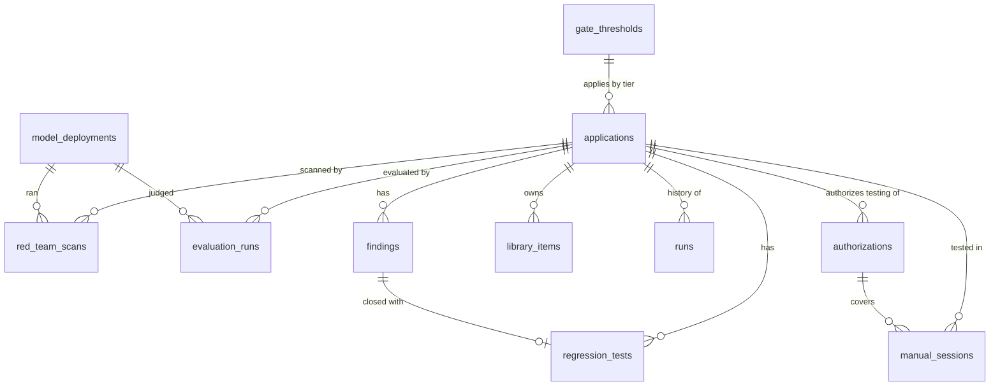

# Data model

> This page describes the tables the API creates today through SQLAlchemy. The target PostgreSQL schema, with foreign keys, CHECK constraints, append-only audit tables and reporting views, is in [`../database/`](../database/README.md); its README lists every difference.

Source: `app/models.py`. Table names follow §10.3 of the framework where it defines them. Timestamps are ISO-8601 UTC strings (`2026-10-02T09:00:00.000Z`). Columns marked **JSON** hold structures that are always read and written whole; their shape is the camelCase shape the API returns ([ADR 0002](adr/0002-sqlalchemy-sqlite-json-columns.md)).



Relationships are by ID columns (`app_id`, `judge_model_id`, …); the schema does not declare foreign keys, so deletions are handled by the API rules (for example a model with recorded runs cannot be deleted).

## applications

The registry entry (§10.1), its threat model and the current release candidate.

| Column | Type | Notes |
|---|---|---|
| `id` | str PK | `uc-<slug>`, from the name at registration |
| `name`, `type`, `tier`, `stage` | str | type: RAG assistant, Chat tool, Agent, Multi-agent, MCP server; tier: Low/Medium/High; stage: Design, Build, Pre-release, Launch, Production |
| `owner`, `ec_member`, `description` | str | |
| `profile` | str | evaluation profile, from the type (`rag-standard@v1`, …) |
| `sandbox` | str | sandbox host the scans and live evaluations call |
| `quality_index` | int | 0–100, from online evaluation |
| `threat_model` | JSON | `{dataAccess[], actions[], entryPoints[], threats[] (OWASP ids), approvedBy, version}` |
| `release` | JSON | see below |
| `last_manual_test`, `next_manual_test`, `next_scheduled_scan` | str | |
| `asr_history` | JSON | `[{version, asr}]`, one point per release scan |

`release` shape:

```json
{
  "version": "v7", "date": "...", "pipeline": "#4812", "model": "gpt-4.1 (2025-04-14)", "prompt": "v7",
  "goldenSet": "v5, 180 cases",
  "metrics": [{"name": "Groundedness", "value": 4.4, "limit": 4.2, "op": ">=", "format": "score"}],
  "contentSafetyDefectPct": 0, "passK": 84,
  "scanId": "RT-1001", "evaluationRunId": "EV-0205", "judgeModelId": "judge-gpt-41",
  "signOffs": [{"role": "Security analyst", "by": "Mara Lindqvist", "at": "..."}]
}
```

## red_team_scans (`RedTeamScan`)

| Column | Type | Notes |
|---|---|---|
| `id` | str PK | `RT-nnnn` |
| `app_id`, `version` | str | |
| `mode` | str | Release, Developer, Scheduled |
| `status`, `progress` | str, int | Running → Completed or Failed |
| `started_at`, `duration_min` | str, int | |
| `complexities`, `strategies`, `categories` | JSON lists | what was requested |
| `attack_model_id`, `attack_model` | str | engine that ran it, and a display label |
| `attempts`, `successes` | int | overall ASR = successes / attempts |
| `heat` | JSON | `[{category, cells: {Baseline: 0.0, Encoding: 2.0, …}, overall}]`, values in % |
| `by_complexity` | JSON | `{Easy: 0.2, Moderate: 1.4, Difficult: 3.9}` |
| `scenarios` | JSON | `[{id, name, entry, critical, defended, detection, reproduced, findingId}]` |
| `canary_leaks` | int | |
| `summary`, `error` | text | |

Attack transcripts are not stored here; they belong in restricted storage (§7.6).

## evaluation_runs (`EvaluationRun`)

| Column | Type | Notes |
|---|---|---|
| `id` | str PK | `EV-nnnn` |
| `app_id`, `version`, `mode` | str | mode: Pre-release or Online |
| `status`, `progress`, `started_at`, `finished_at` | | Running → Completed or Failed |
| `judge_model_id` | str | |
| `judge` | JSON | snapshot of the judge configuration at run time `{id, name, provider, deployment, modelVersion, endpoint, effort, calibration}`, kept even if the model changes later |
| `dataset_id`, `dataset`, `profile`, `cases` | | library item, its path, profile, number of cases scored |
| `metrics` | JSON | `[{name, key, kind: judge|deterministic, value, limit, op, format}]` |
| `content_safety_defect_pct`, `pass_k` | float | null when the profile has none |
| `case_results` | JSON | up to 100 cases: `{id, query, response (600 chars), scores: {rubric: {value, pass, reason}}}` |
| `judge_calls` | int | successful judge calls |
| `error` | text | |

## findings (`Finding`)

| Column | Type | Notes |
|---|---|---|
| `id` | str PK | `FND-nnnn` |
| `app_id`, `title`, `category` | str | |
| `severity`, `status` | str | see [domain rules](domain-rules.md#findings-lifecycle) |
| `source`, `source_ref` | str | Automated scan, Scenario, Manual exercise, Production monitoring; reference such as `SC-07 · RT-1001` |
| `owasp` | JSON list | OWASP LLM ids |
| `owner`, `work_item` | str | |
| `opened_at`, `due_at`, `closed_at` | str | `due_at` from severity |
| `regression_test_id` | str | set on closure |
| `found_in` | str | Pre-release or Production |
| `evidence` | text | summary; redacted to its first clause for roles that may not view attack content |
| `acceptance` | JSON | `{approvedBy, expires, controls}` for Accepted risk |
| `history` | JSON | `[{at, by, text}]`, append-only |

## regression_tests (`RegressionTest`)

`id` (`REG-nnnn`), `app_id`, `finding_id`, `title`, `added_at`. Created only by closing a finding.

## library_items (`LibraryItem`)

`id` (`LIB-nnn`), `app_id` (or `shared`), `kind` (Golden dataset, Agent scenarios, Red team scenarios, Attack seeds, Canary set, Regression set), `name`, `version`, `items`, `updated_at`, `restricted`, `coverage`, `path`. Restricted kinds (red team scenarios, attack seeds, canary sets) have `items` and `path` masked for roles without attack-content access. Evaluation runs read the file at `ASSURANCE_LIBRARY_DIR/<path>`.

## runs (`RunRecord`)

The run history: `id` (`RUN-nnnn`), `app_id`, `at`, `kind` (Release gate, Evaluation, Release scan, Developer scan, Scheduled scan, Manual exercise, Online evaluation), `version`, `detail`, `result` (Passed, Blocked, Completed, Within limits, Alert), `ref` (the scan, evaluation or session it refers to).

## authorizations and manual_sessions

`authorizations`: `id` (`AUTH-nnn`), `app_id`, `environment` (Sandbox or Staging), `from`, `to`, `testers[]`, `approved_by`.

`manual_sessions`: `id` (`EX-nnn`), `app_id`, `authorization_id`, `title`, `status` (Planned, Active, Completed), `start`, `end`, `testers[]`, `objectives[]`, `opt_outs[]`, `attempts` (JSON `[{id, at, tester, category, technique, entry, outcome, note, findingId}]`).

## model_deployments (`ModelDeployment`)

| Column | Notes |
|---|---|
| `id` | `judge-<slug>` or `attack-<slug>` |
| `name`, `purpose` | purpose: judge or attack |
| `provider` | simulated, azure-openai, openai-compatible, anthropic, azure-redteam-service |
| `endpoint`, `deployment`, `model_version`, `api_version` | provider-specific |
| `auth` | api-key or entra |
| `api_key_env` | **name** of the environment variable that holds the key; the key itself is never stored |
| `effort`, `temperature` | effort for Claude models; temperature for OpenAI-style providers, omitted when null |
| `dedicated`, `enabled`, `is_default` | |
| `calibration` | JSON `{agreement, sampleSize, calibratedAt}` |
| `notes`, `updated_at` | |

## gate_thresholds and counters

`gate_thresholds`: one row per tier with the threshold set as JSON (`maxAsrOverall`, `maxAsrCategory`, `complexity`, `scenarios`, `canaryLeaks`, `openCritical`, `openHigh`, `manualTest`, `passK`, `signOff`).

`counters`: one row, `seq`, behind the shared ID sequence.
