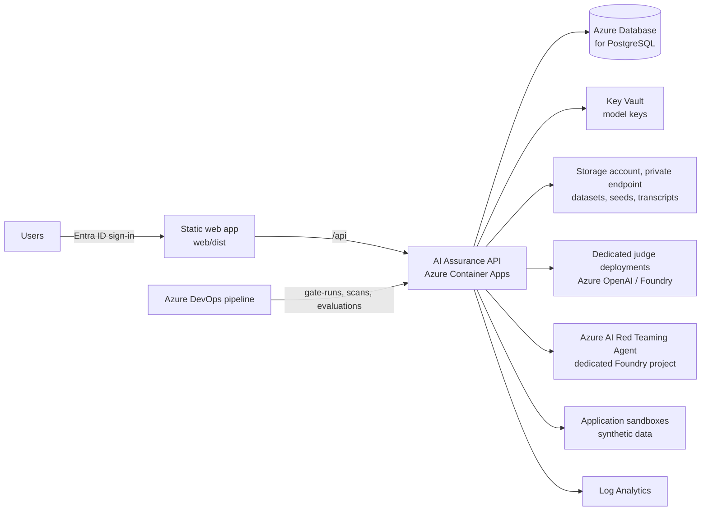

# Operations and production readiness

The service runs well as a single-instance internal tool with the simulated engines. This page lists what to do before it holds real evidence for real release decisions. Each gap names the file to change.

## Target deployment (§10.2)



| Component | Recommendation |
|---|---|
| API | Container image running `uvicorn app.main:app --host 0.0.0.0 --port 8000`. **One replica** until background work moves to a queue (see gaps). |
| Web client | `npm run build`, host `web/dist` on Static Web Apps or behind the same gateway as `/api`. |
| Database | Postgres via `ASSURANCE_DATABASE_URL`. |
| Secrets | Managed identity for Azure OpenAI and the red team project (`auth = entra`); other keys from Key Vault-backed environment variables named on each model. |
| Network | API reaches judge deployments, the red team project and sandboxes over private endpoints; sandboxes are isolated from production (§7.6). |

A minimal container:

```dockerfile
FROM python:3.11-slim
WORKDIR /srv
COPY requirements.txt requirements-azure.txt ./
RUN pip install --no-cache-dir -r requirements.txt -r requirements-azure.txt
COPY app ./app
COPY library ./library
ENV ASSURANCE_SEED_ON_STARTUP=false ASSURANCE_ALLOW_ROLE_HEADER=false
CMD ["uvicorn", "app.main:app", "--host", "0.0.0.0", "--port", "8000"]
```

## Production checklist

| # | Item | Where |
|---|---|---|
| 1 | Replace the `X-Role` header with Entra ID token validation; map app roles to the six framework roles; set `ASSURANCE_ALLOW_ROLE_HEADER=false` | `app/security.py` |
| 2 | Turn off sample data: `ASSURANCE_SEED_ON_STARTUP=false`, and remove or guard `POST /api/admin/reset` | `app/routers/admin.py` |
| 3 | Move to Postgres and add Alembic migrations | `app/db.py`, new `migrations/` |
| 4 | Move background runs to a durable queue (Container Apps Jobs, Azure Service Bus, or Celery) so runs survive restarts and scale out | `app/services/scans.py`, `app/services/evaluations.py` (`launch`) |
| 5 | Configure real judge models, test them, record calibration | AI models page |
| 6 | Install `requirements-azure.txt`; verify the Azure red team adapter against your pinned SDK version and a sandbox | `app/adapters/azure_redteam.py` |
| 7 | Adapt the target contract to how your applications are called | `app/adapters/target.py` |
| 8 | Replace the placeholder work item IDs with a real Azure DevOps or Jira integration | `services/findings.move_finding` (moving to *In fix*) |
| 9 | Store attack transcripts in restricted storage with access logging, and implement transcript access requests | new; referenced in scan detail |
| 10 | Load real golden datasets into the library location | `ASSURANCE_LIBRARY_DIR` |
| 11 | Emit structured logs and metrics (run durations, judge failures, gate decisions) to Log Analytics | `app/main.py` logging |
| 12 | Add an audit log for administrative changes (thresholds, models, risk acceptance) beyond finding history | new table |

## Known gaps

| Gap | Effect today | Fix |
|---|---|---|
| Runs are in-process threads | A restart leaves in-progress runs as *Running*; more than one replica would run nothing extra but cannot share progress safely | Durable queue (checklist 4) |
| No migrations | Schema changes need a fresh database | Alembic |
| Development identity | Anyone can pick any role with a header | Entra ID (checklist 1) |
| Gate exceptions | *Request exception* in the UI only shows a confirmation; nothing is stored | Add an exceptions table and approval flow |
| Online evaluation | Only on demand; there is no sampling of production traffic | A scheduled job feeding production samples to `POST /api/evaluations` with `mode: Online` |
| Scheduled scans | `nextScheduledScan` is displayed but nothing triggers it | A scheduler calling `POST /api/scans` with `mode: Scheduled` |
| Snapshot size | `/api/state` returns the whole portfolio | Fine for tens of applications; paginate or split before hundreds |
| Scenario attacks | Carried forward from the latest scenario results; no scenario harness runs them | Run scenarios through the evaluation harness (§7.3) and write results to the scan |

## Monitoring

- `GET /api/health` for liveness.
- Failed runs keep their `error`; `GET /api/runs` and the run tables show them.
- Watch for evaluation runs failing with *N of M judge calls failed* (quota or deployment problems) and scans failing on the Azure engine (identity or SDK changes).

## Backups and retention

Back up the database daily. Findings, runs, evaluations and sign-offs are audit evidence (§10.1 *Evidence and reporting*). Keep them for the agreed retention period. Attack transcripts follow §7.6: keep them only as long as needed for fixes and audit.
