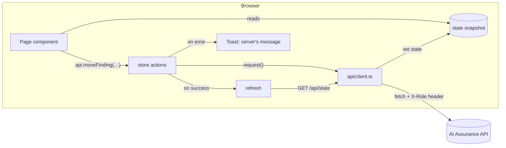

# Architecture

## 1. Principles

1. **The API is the source of truth.** The client stores nothing important. Every rule (gate, lifecycle, permissions, safety rules) is enforced by the API. The client shows the API's results and messages ([ADR 0004](adr/0004-snapshot-store.md)).
2. **One consistent view.** All screens read from one snapshot of the portfolio, so a change made on one screen shows everywhere at once.
3. **The server's words reach the user.** When the API refuses something, its `detail` message appears in a toast unchanged. Messages are written for people on the server side.

## 2. Data flow



### The store (`src/store/store.tsx`)

`StoreProvider` owns three things:

| Piece | What it does |
|---|---|
| `state` | The latest `GET /api/state` response (`AppState` in `domain/types.ts`). Until it loads, the provider shows a loading screen. If the API is unreachable it shows *Cannot reach the AI Assurance API* with the command to start it and a Retry button. |
| `role` | The role being previewed. Kept in `localStorage` (`ai-assurance-role`) and sent as `X-Role` on every request. Changing it refetches the snapshot, because what the server returns depends on the role. |
| `api` | One function per action. Each calls the endpoint, then refreshes the snapshot. On failure it shows the server's message as an error toast and resolves to `undefined`; on success it resolves to the response (or `true` for empty responses). |

Pages use it like this:

```tsx
const { state, api } = useStore();
const r = await api.moveFinding(f.id, 'Closed', { regressionTitle: title });
if (r) { toast(`${f.id} closed · ${r.regressionTestId} added to the regression set`); onClose(); }
```

Because failures are already shown, pages only handle the success case.

### Actions

| Action | Endpoint |
|---|---|
| `registerApp` | `POST /api/applications` |
| `rerunGate`, `signOff` | `POST /api/applications/{id}/gate-runs`, `/sign-offs` |
| `startScan` | `POST /api/scans` |
| `startEvaluation`, `getEvaluation` | `POST /api/evaluations`, `GET /api/evaluations/{id}` |
| `logFinding`, `updateFinding`, `moveFinding` | `POST /api/findings`, `PATCH /api/findings/{id}`, `POST …/transitions` |
| `createSession`, `setSessionStatus`, `logAttempt`, `findingFromAttempt` | `/api/sessions/…` |
| `updateThresholds`, `reset` | `PATCH /api/thresholds/{tier}`, `POST /api/admin/reset` |
| `createModel`, `updateModel`, `setDefaultModel`, `deleteModel`, `testModel` | `/api/models/…` |
| `setRole`, `refresh` | local |

`testModel` and `getEvaluation` only read, so they do not refresh the snapshot.

### Polling for background work

While any scan or evaluation in the snapshot has status `Running`, the store refetches every second. Progress bars and *Running* badges update from those refetches; polling stops when nothing is running.

### Data loaded on demand

The snapshot leaves out evaluation case results (per-case judge verdicts), which can be large. The evaluation detail screen loads them with `api.getEvaluation(id)` once the run is complete.

## 3. Routing

`HashRouter` (URLs like `/#/findings?open=FND-0231`) so the built app works on any static host without server rewrite rules ([ADR 0003](adr/0003-hash-routing.md)).

| Route | Page |
|---|---|
| `/` | Dashboard |
| `/applications`, `/applications/:id` | Registry; application overview (tabs: Overview, Threat model, Configuration) |
| `/runs` | Run history (`?app=`, `?kind=`) |
| `/evaluations`, `/evaluations/:id` | Evaluation runs; evaluation detail |
| `/scans`, `/scans/:id` | Red team scans; scan detail |
| `/findings` | Findings board (`?app=`, `?q=`, `?open=<finding id>` opens the drawer) |
| `/library` | Test library |
| `/manual`, `/manual/:id` | Manual testing; session workspace |
| `/evidence`, `/evidence/:id` | Evidence pack |
| `/models` | AI models (judges and attack engines) |
| `/admin` | Administration |

Query parameters hold view state that should survive a reload or be shareable (filters, the open finding).

## 4. Permissions in the client

`domain/framework.ts` mirrors the server's role → permission table (`can(role, perm)`) and the sign-off rule (`canSignOff`). The client uses it **only** to hide or disable controls the user cannot use, so they do not click something that will be refused. The server checks every request regardless. If the two ever disagree, the server wins and the user sees its message ([ADR 0006](adr/0006-permission-mirror.md)).

Some screens also use the snapshot itself to decide what to show: if the server returned no manual sessions for this role, the manual testing screen shows a locked panel.

## 5. Providers

```tsx
<ToastProvider>          // toasts; the store uses it for API errors
  <StoreProvider>        // snapshot, role, api actions, polling
    <TooltipProvider>    // one shared tooltip for charts
      <HashRouter>
        <Layout>         // sidebar, top bar, role switcher, theme
          <Outlet/>      // the page
```

`ToastProvider` is outside the store because the store reports errors through it.

## 6. Types

`domain/types.ts` describes the API's responses: `AppState`, `Application` (with its server-computed `gate`), `Scan`, `Finding`, `EvaluationRun`, `ModelDeployment` and the rest. They are maintained by hand to match `backend/app/models.py` and `serialize.py`. When the API changes a response, update this file in the same change. A later improvement is to generate these types from the API's OpenAPI schema.

## 7. Theme

`Layout` sets `data-theme="light"` or `"dark"` on `<html>`, from the saved choice (`ai-assurance-theme` in `localStorage`) or the operating system preference. All colors are CSS variables redefined under `[data-theme='dark']`. See [design system](design-system.md).
